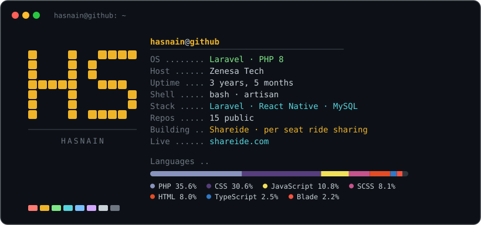

  

  <a href="https://shareide.com"><strong>shareide.com</strong></a>
  &nbsp;·&nbsp;
  <a href="https://github.com/YesmeHasnain?tab=repositories">repositories</a>

---

### Shareide

A per seat ride sharing platform for Pakistan: you book a seat on a car that is
already going your way instead of paying for the whole car. Monthly pick and
drop with the same CNIC verified driver, women safe rides, and intercity travel
priced per seat.

Two React Native apps on a Laravel API — passenger, driver, admin panel and the
marketing site in one monorepo.

<!--
  The card above is generated, not hand-written: `gen_card.py` reads the figures
  off the GitHub API and redraws `card-dark.svg`. The language split is real byte
  counts across every public repo, so re-run it rather than editing a number by
  hand.

  It is an SVG and not a fenced code block because GitHub markdown renders no
  ANSI colour. It carries its own dark background so it reads the same under both
  GitHub themes. Values anchor to the right edge rather than being padded with
  dots, which also removes every dependence on the reader's monospace advance
  width -- a README image gets no webfont, so whatever face the reader has is the
  one that draws it.
-->
